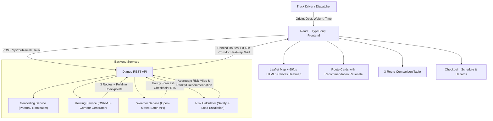

# 🚚 Weather-Aware Truck Routing

> An intelligent, safety-first routing web application that evaluates live weather, truck load weight, and travel times to recommend the safest highway corridor for heavy commercial freight.

Built with **React (TypeScript + Tailwind CSS + Leaflet)** and **Django (Django REST Framework)** for the **Spotter Full Stack Challenge**.

---

## 🌟 Key Capabilities

- **3 Alternative Route Corridors**: Automatically generates 3 distinct, drivable highway routes between any origin and destination via OSRM.
- **Dynamic Checkpoint Sampling**: Samples checkpoints every **10, 25, or 50 miles**, estimating the truck's exact arrival time (ETA) at every milepost.
- **Hourly Weather Forecasts at ETA**: Queries Open-Meteo for high-resolution weather conditions (wind speed, wind gusts, rain rate, snowfall rate, temperature) matching the truck's arrival hour.
- **Load-Aware Safety Escalation**: Implements strict load weight rules where crosswinds are escalated to **Severe** (&gt;40,000 lb) or **No Travel** (&gt;30,000 lb).
- **Multi-Factor Recommendation Hierarchy**: Ranks routes by preferring:
  1. Fewest **Severe** miles (0 No Travel miles prioritized)
  2. Fewest **High** miles
  3. Lowest **average risk** score
  4. Shortest **travel times**
- **0–48h Corridor Forecast Heatmap**: Real-time 60 FPS HTML5 Canvas heatmap with 0–48 hour forecast slider, variable switching (Risk, Wind, Rain, Snow, Temp), and automated playback simulation.

---

## 📐 Safety Thresholds & Risk Rules

### Weather Classification Thresholds

| Condition | Low | Moderate | High | Severe | No Travel |
| :--- | :---: | :---: | :---: | :---: | :---: |
| **Wind Speed** | &lt; 25 mph | 25 – 34 mph | 35 – 44 mph | 45 – 54 mph | **≥ 55 mph** |
| **Rain Rate** | &lt; 0.10 in/hr | 0.10 – 0.25 in/hr | 0.25 – 0.50 in/hr | 0.50 – 1.00 in/hr | **&gt; 1.00 in/hr** |
| **Snowfall** | &lt; 0.5 in/hr | 0.5 – 1.0 in/hr | 1.0 – 2.0 in/hr | 2.0 – 3.0 in/hr | **&gt; 3.0 in/hr** |

### Load Weight Escalation Rules

- **≥ 55 mph wind** $\rightarrow$ **No Travel** for *any* load weight (extreme rollover risk).
- **45–54 mph wind + Load &gt; 30,000 lb** $\rightarrow$ Escalated from Severe to **No Travel**.
- **35–44 mph wind + Load &gt; 40,000 lb** $\rightarrow$ Escalated from High to **Severe**.

### Route Recommendation Hierarchy

Routes are sorted using a multi-factor priority tuple:
$$\text{Sort Priority} = (\text{No Travel Miles}, \text{Severe Miles}, \text{High Miles}, \text{Average Risk Score}, \text{Duration Seconds})$$

---

## 🏗️ Architecture Overview



---

## 🚀 Quick Start Guide

### Prerequisites
- **Python 3.10+**
- **Node.js 18+** and **npm**
- *(Optional)* **Docker & Docker Compose**

---

### Option 1: Turnkey Local Development

#### 1. Backend Setup (Django)
```bash
# Navigate to backend
cd backend

# Create virtual environment & activate
python -m venv venv
# Windows:
.\venv\Scripts\activate
# macOS/Linux:
source venv/bin/activate

# Install dependencies
pip install -r requirements.txt

# Run migrations
python manage.py migrate

# Start backend server
python manage.py runserver 8000
```
Backend API will be running at `http://127.0.0.1:8000`.

#### 2. Frontend Setup (React + Vite)
In a new terminal:
```bash
# Navigate to frontend
cd frontend

# Install packages
npm install

# Start Vite dev server
npm run dev
```
Open your browser at **`http://localhost:5173`**.

---

### Option 2: Docker Compose (One Command)

```bash
docker-compose up --build
```
- Frontend: `http://localhost:5173`
- Backend: `http://localhost:8000`

---

## 🧪 Running Automated Unit Tests

The backend includes an automated test suite verifying threshold boundaries, load rules, and recommendation sorting:

```bash
cd backend
python manage.py test routing.tests
```

**Test Coverage Summary:**
- ✅ Base wind, rain, and snow threshold classifications
- ✅ Load weight escalation rules (&gt;30,000 lb and &gt;40,000 lb triggers)
- ✅ Checkpoint multi-factor composite risk
- ✅ Route risk aggregation (segment miles calculation)
- ✅ 4-tier recommendation hierarchy sorting
- ✅ Endpoints, validation, and serialization

---

## 📡 API Reference

### `POST /api/routes/calculate/`
Calculates 3 alternative routes, checkpoint arrival ETAs, sampled weather, risk summaries, and 48h heatmap grid.

**Request Payload:**
```json
{
  "origin": "New York, NY",
  "destination": "Chicago, IL",
  "departure_time": "2026-11-08T16:00:00Z",
  "load_weight_lb": 42000,
  "sample_interval_miles": 25
}
```

**Response Format:**
```json
{
  "origin": { "name": "New York, NY", "lat": 40.7128, "lon": -74.006 },
  "destination": { "name": "Chicago, IL", "lat": 41.8781, "lon": -87.6298 },
  "departure_time": "2026-11-08T16:00:00Z",
  "load_weight_lb": 42000,
  "sample_interval_miles": 25,
  "recommended_route_id": 1,
  "routes": [
    {
      "id": 1,
      "name": "Corridor A (Primary)",
      "color": "#2563eb",
      "summary": "via I-80 W",
      "distance_miles": 790.5,
      "duration_seconds": 53460,
      "duration_formatted": "14 hrs 51 mins",
      "is_recommended": true,
      "recommendation_badge": "SAFEST & RECOMMENDED",
      "recommendation_rationale": "Optimal route balancing weather risk and travel time: Zero 'No Travel' hazard miles, Zero Severe weather miles, Lowest composite risk (1.0/5.0), ETA: 14 hrs 51 mins.",
      "risk_summary": {
        "no_travel_miles": 0.0,
        "severe_miles": 0.0,
        "high_miles": 0.0,
        "moderate_miles": 0.0,
        "low_miles": 790.5,
        "average_risk_score": 1.0,
        "average_risk_level": "Low",
        "worst_risk_level": "Low"
      },
      "checkpoints": [...]
    }
  ],
  "heatmap": {
    "bounds": { "min_lat": 39.5, "max_lat": 42.5, "min_lon": -88.5, "max_lon": -73.5 },
    "points_count": 57,
    "hours": [
      {
        "hour_offset": 0,
        "label": "+0h (Sat 04 PM)",
        "points": [...]
      }
    ]
  }
}
```

### `GET /api/presets/`
Returns preconfigured high-freight logistics corridors and key hubs.

### `GET /api/geocode/?q={query}`
Fast autocomplete suggestions powered by Photon and OpenStreetMap.

---

## ⚖️ License
MIT License. Built for the Spotter Developer Challenge.
